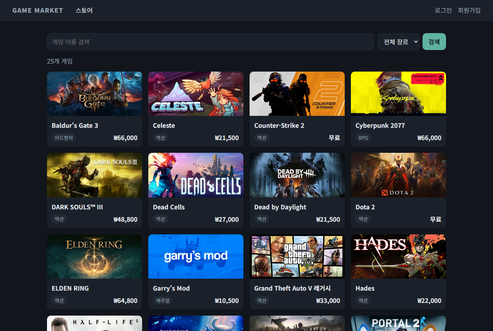
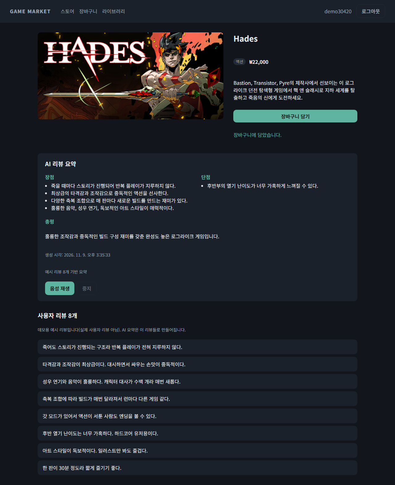
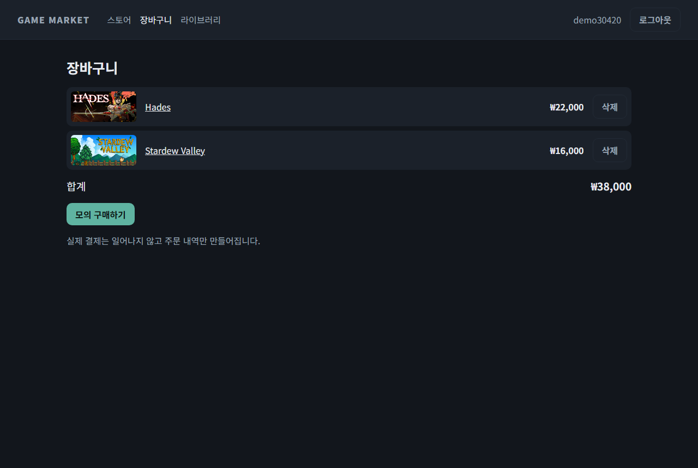
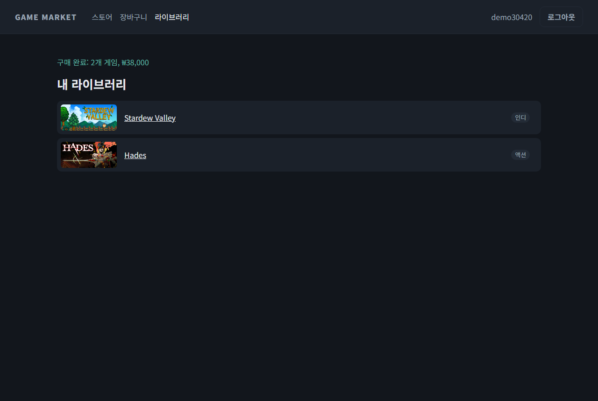

# Game Market

[](https://github.com/euiseok00/game-market/actions/workflows/ci.yml)

가상 게임 스토어(검색·장바구니·모의 구매·라이브러리)에 **Steam 리뷰 AI 요약(Gemini)** 과 **브라우저 음성 읽기(TTS)** 를 붙이고, 요약 생성 방식 3단계(none / lazy / warm)의 응답 시간을 측정한 포트폴리오 프로젝트입니다. 설계 문서: [`MVP.md`](MVP.md)

- 백엔드: Java 21, Spring Boot 4.1.2, Spring Security(BCrypt, 세션), Spring Data JPA, PostgreSQL, Spring AI 2.0.2 (`spring-ai-starter-model-google-genai`)
- 프론트: React + TypeScript + Vite (UI와 `speechSynthesis`만 담당)
- 모델: `gemini-3.5-flash-lite` (Gemini API 무료 티어). 유료 호출로 자동 전환하지 않습니다.

## 화면

| 스토어 | 게임 상세 + AI 리뷰 요약 |
|---|---|
|  |  |
| **장바구니** | **구매 완료 / 내 라이브러리** |
|  |  |

게임 상세 화면에서 요약의 근거가 된 리뷰 목록을 누구나 볼 수 있고(`GET /api/games/{id}/reviews`), 요약 아래에는 리뷰 출처와 개수가 표시됩니다(`Steam 사용자 리뷰 N개` 또는 `예시 리뷰 N개`). Steam 리뷰 API에 접근할 수 없어 현재는 **게임마다 직접 작성한 예시 리뷰 8개**(`seed/reviews.json`, 실제 사용자 리뷰 아님)를 사용합니다. 이 프로젝트의 핵심은 리뷰를 확인하고 그 요약을 음성으로 듣는 흐름이라, 리뷰는 각 게임의 실제 특징을 반영한 데모 데이터로 충분하다고 판단했습니다.

## 실행

### Docker Compose (전체)

```bash
export GEMINI_API_KEY=...        # PowerShell: $env:GEMINI_API_KEY = "..."
docker compose up -d --build
```

- 스토어: http://localhost:3000 (nginx가 `/api`를 백엔드로 프록시)
- API: http://localhost:8080
- PostgreSQL: `localhost:5433` (로컬에 설치된 PostgreSQL과 5432가 겹치지 않도록 5433 사용)

키가 없어도 앱은 뜹니다. 이때 스토어 기능은 정상이고 AI 요약만 `503 SUMMARY_UNAVAILABLE`을 돌려줍니다.

### 로컬 개발

```bash
docker compose up -d postgres
cd backend && ./gradlew bootRun          # :8080, GEMINI_API_KEY 환경변수 필요
cd frontend && npm install && npm run dev # :5173, /api 프록시
```

### 테스트

```bash
cd backend && ./gradlew test   # 단위·통합 테스트 (Testcontainers, Docker 필요)
cd frontend && npm test        # 컴포넌트 테스트 (Vitest)

# E2E (Playwright): 실행 중인 스택을 대상으로 합니다. 기본 http://localhost:3000
docker compose up -d --build
cd frontend && npx playwright install chromium && npm run e2e
# 다른 주소: E2E_BASE_URL=http://localhost:5173 npm run e2e
```

E2E는 가입 → 검색 → 장바구니 → 모의 구매 → 라이브러리 흐름, 요약 패널(장점·단점·출처 표시, 음성 재생/중지, 503 오류, 음성 미지원 시 비활성화), 비로그인 리다이렉트를 확인합니다. Gemini 키나 무료 한도에 의존하지 않도록 요약 API와 `speechSynthesis`는 E2E에서 스텁으로 대체합니다(실제 요약 경로는 백엔드 테스트가 검증).

README 스크린샷 다시 찍기(실제 Gemini 키로 실행 중인 스택 필요): `cd frontend && SCREENSHOTS=1 npx playwright test screenshots`

GitHub Actions(`.github/workflows/ci.yml`)가 push·PR마다 백엔드 테스트, 프론트 타입체크·테스트·빌드, Docker Compose 스택 대상 E2E를 실행합니다.

### 설정

| 환경변수 | 기본값 | 설명 |
|---|---|---|
| `GEMINI_API_KEY` | `not-set` | Gemini API 키. 저장소에 커밋하지 않습니다. 미설정 시 앱은 뜨고 요약만 503 |
| `GEMINI_MODEL` | `gemini-3.5-flash-lite` | 요약 모델 |
| `SUMMARY_MODE` | `lazy` | `none` / `lazy` / `warm` (`summary.mode`) |
| `GAMEMARKET_DB_URL` / `_USER` / `_PASSWORD` | `jdbc:postgresql://localhost:5433/gamemarket`, `gamemarket`, `gamemarket` | DB 연결 |

요약 모드:
- `none`: 요청마다 리뷰 수집과 Gemini 호출을 하고 저장하지 않습니다.
- `lazy`: 첫 요청에서 생성해 `review_summary`에 저장하고, 이후 요청은 DB에서 읽습니다.
- `warm`: 서버 시작 시 시드 게임 전체 요약을 미리 만들어 둡니다.

## 요약 응답 시간 (A/B/C)

[`docs/benchmark.md`](docs/benchmark.md)에 전체 표가 있습니다(예시 리뷰 교체 전 템플릿 시드로 측정, 시간 비교에는 영향 없음). 2026-11-09 측정, 게임 25개 × 3회, `summary_log.total_ms` 기준:

| 단계 | 방식 | 평균 (ms) | p95 (ms) |
|---|---|---:|---:|
| A | none (요청마다 수집 + Gemini) | 1313.7 | 1610 |
| B | lazy 첫 요청 | 1956.2 | 2062 |
| B | lazy 이후 요청 | 11.9 | 33 |
| C | warm | 4.4 | 12 |

재측정: `docker compose up -d postgres` 후 `cd backend && SPRING_PROFILES_ACTIVE=bench ./gradlew bootRun`. 무료 한도를 넘지 않도록 LLM 호출 사이에 4.5초씩 쉽니다(`bench.llm-interval-ms`).

## Steam 리뷰 엔드포인트 상태

2026-11-09에 Java `RestClient`로 `https://store.steampowered.com/appreviews/{appid}?json=1`를 호출하면 `302 FOUND text/html`(스토어 홈으로 리다이렉트)이 돌아와 JSON을 받을 수 없었습니다. 헤더 위장은 하지 않으므로 **현재는 시드 리뷰를 사용합니다** (`backend/src/main/resources/seed/reviews.json`, 게임별 예시 리뷰). `FallbackReviewSource`가 Steam 호출이 실패하거나, JSON이 아니거나, 리뷰가 0건이면 자동으로 시드로 넘어갑니다. 게임 메타데이터(이름·장르·이미지·설명)는 `appdetails`(`l=koreana&cc=kr`)에서 한 번 받아 `seed/games.json`에 저장했고, 가격은 모의값입니다.

## 오류 처리

- 같은 게임에 요약 요청이 동시에 들어오면 한 번만 생성합니다(게임별 single-flight + `review_summary.game_id` unique 제약).
- Gemini 429·5xx 응답은 지수 백오프(1s, 2s, 4s)로 최대 3회 재시도합니다. 잘못된 JSON, 빈 응답, 비어 있는 장점·단점, 20초 타임아웃(`summary.llm-timeout-ms`)은 재시도하지 않습니다. 같은 게임 생성을 기다리는 요청은 최대 60초(`summary.wait-timeout-ms`) 후 503을 받습니다. 모두 `503 {code:"SUMMARY_UNAVAILABLE"}`로 응답하고 요약 행은 저장하지 않습니다. Spring AI 내장 재시도는 `spring.ai.retry.max-attempts=1`로 껐습니다.
- 한국어 음성이 없거나 `speechSynthesis`를 지원하지 않는 브라우저에서는 재생 버튼이 비활성화되고 안내 문구가 나옵니다.

## MVP 완료 기준 (`MVP.md` 10장)

- [x] 회원가입·로그인 후 게임 검색, 장바구니 담기
- [x] 실제 결제 없이 모의 주문 생성, 내 라이브러리 확인
- [x] 최초 AI 요약 요청 시 리뷰 수집 + Gemini 요약 (Steam은 현재 시드로 폴백)
- [x] 요약 DB 저장, 두 번째 요청부터 외부 API 호출 없음 (`summary_log`의 `fetch_ms=0, llm_ms=0`으로 확인)
- [x] 동시 요청 시 중복 생성 없음 (`SummaryConcurrencyTest`: 20개 동시 요청에 Gemini 1회, 행 1개)
- [x] 장점·단점·총평 표시와 브라우저 음성 재생
- [x] Gemini 한도 초과·장애 시 서비스 유지, 오류 안내 (키 없이 기동해도 스토어는 동작)
- [x] A/B/C 응답 시간 평균·p95 표
- [x] Steam 리뷰 수집 실패 시 시드 리뷰 폴백
- [x] 서버 로직은 Spring Boot, React는 UI와 TTS만 담당
