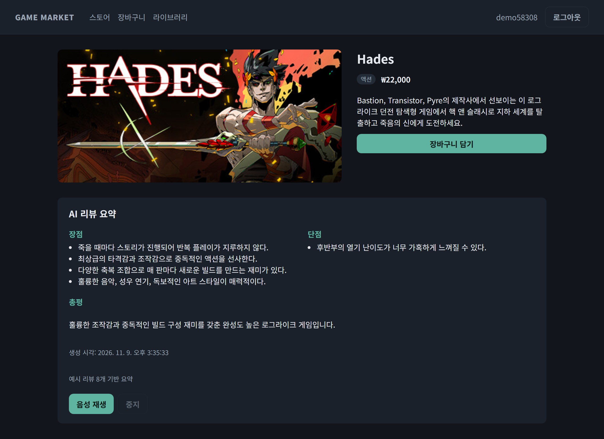
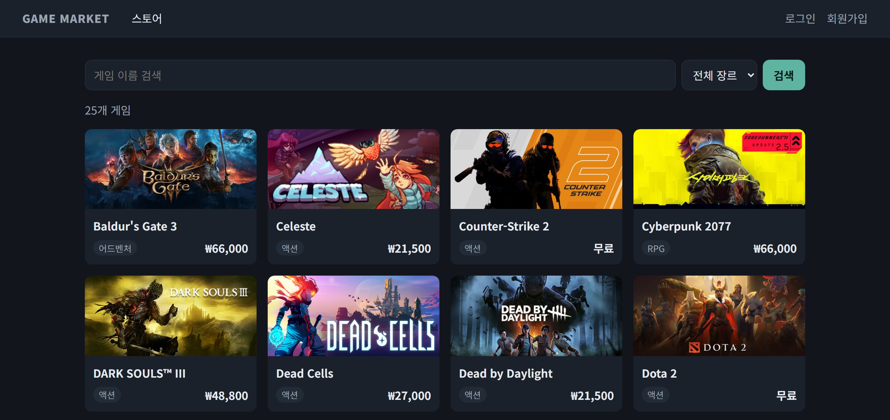
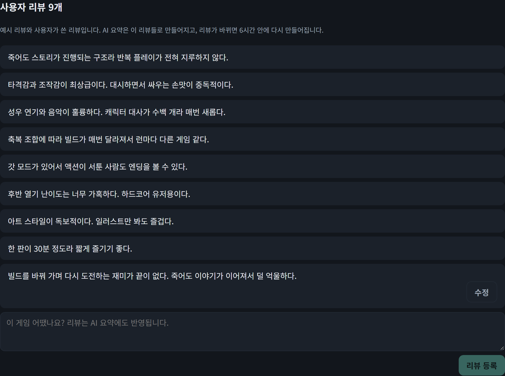
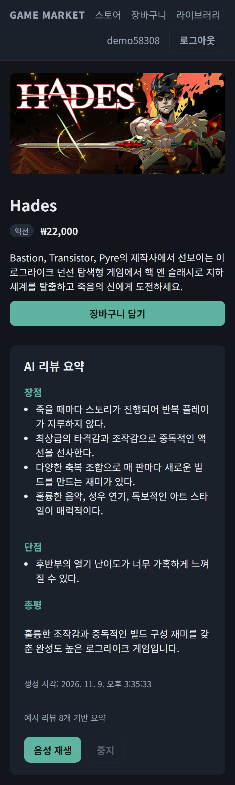
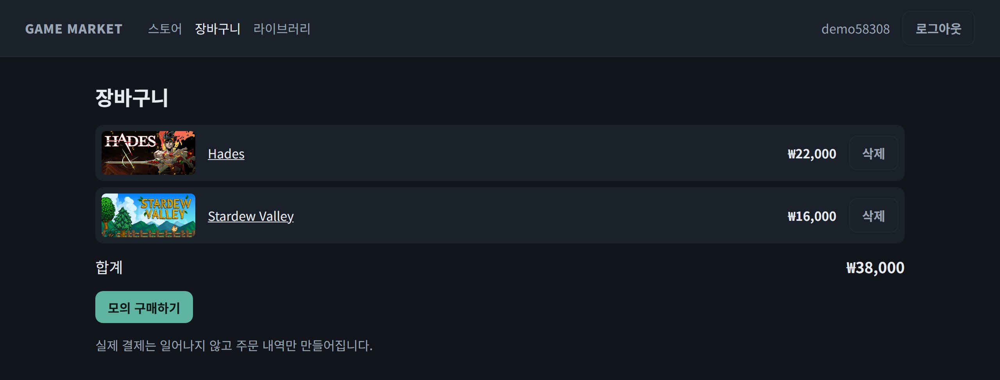
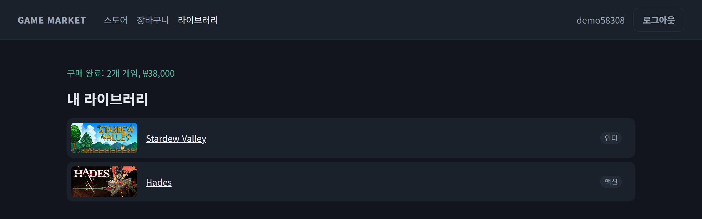
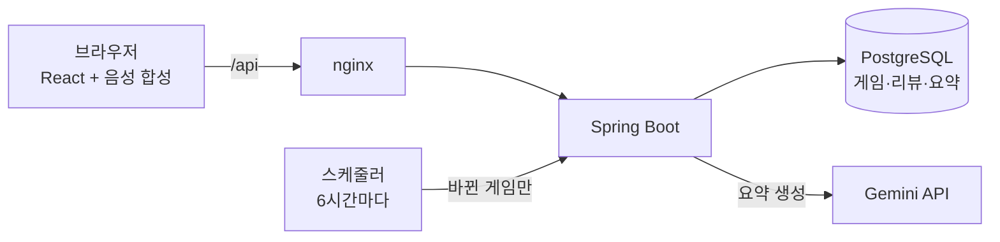

# Game Market

[](https://github.com/euiseok00/game-market/actions/workflows/ci.yml)

**리뷰 수백 개를 다 읽지 않아도, 이 게임이 나에게 맞는지 10초 안에 알 수 있는 게임 스토어.**

게임마다 사용자 리뷰를 AI(Gemini)가 장점·단점·총평으로 요약하고, 그 요약을 음성으로 읽어 줍니다. 리뷰가 새로 달리거나 수정되면 요약도 알아서 최신 상태로 바뀝니다.

<p align="center">
  
</p>

> 실제 결제와 배포가 없는 포트폴리오 프로젝트입니다.

## 사용자는 이렇게 씁니다

1. **게임을 찾습니다.** 이름으로 검색하고 장르로 거릅니다.
2. **AI 요약을 봅니다.** 상세 화면에서 장점·단점·총평을 한눈에 보고, 버튼 하나로 음성으로 듣습니다. 요약이 어떤 리뷰로 만들어졌는지 바로 아래에서 확인할 수 있습니다.
3. **리뷰를 남깁니다.** 로그인하면 리뷰를 쓰고, 내가 쓴 리뷰는 고칠 수 있습니다. 바뀐 리뷰는 6시간 안에 요약에 반영됩니다.
4. **구매합니다.** 장바구니에 담아 모의 구매하고, 산 게임은 라이브러리에 모입니다.



<table>
  <tr>
    <td width="62%" valign="top">
      <b>요약의 근거가 된 리뷰 목록</b><br><br>
      
    </td>
    <td width="38%" valign="top">
      <b>휴대폰 화면 (390px)</b><br><br>
      
    </td>
  </tr>
</table>

<table>
  <tr>
    <td width="50%" valign="top"><b>장바구니와 모의 구매</b><br><br></td>
    <td width="50%" valign="top"><b>구매 후 라이브러리</b><br><br></td>
  </tr>
</table>

## 풀어 낸 문제

### 1. AI 요약은 느리고 비싸다 → 한 번 만들어 DB에 저장

Gemini 호출은 요청마다 1초 이상 걸리고, 무료 한도도 금방 찹니다. 그래서 게임별 요약을 처음 한 번만 만들어 DB(`review_summary`)에 저장하고, 이후 요청은 DB에서 바로 돌려줍니다.

| 기준 | 평균 | p95 |
|---|---:|---:|
| 캐시 도입 전: 요청마다 Gemini 호출 | 1415.2ms | 2434ms |
| 캐시 도입 후: DB에 저장된 요약 조회 | **12.9ms** | **50ms** |

**평균 약 110배, p95 약 49배 빨라졌습니다.** 게임 25개 × 기준별 10회씩, 각 250번 호출한 결과입니다(2026-11-12, `gemini-3.5-flash-lite`, 실패 0건). 값은 서버 안에서 잰 요약 처리 시간이고 HTTP 왕복은 빠져 있습니다. 캐시 도입 후 값에는 게임마다 요약을 처음 만들어 저장하는 호출 1번이 빠져 있습니다. 전체 표: [`docs/benchmark.md`](docs/benchmark.md)

### 2. 리뷰가 바뀌면 요약이 낡는다 → 바뀐 게임만 골라서 다시 요약

캐시를 두면 "언제 다시 만들지"가 문제가 됩니다. 매번 전부 다시 만들면 캐시의 의미가 없고, 그대로 두면 요약이 낡습니다.

- 매일 00·06·12·18시(한국 시간)에 스케줄러가 저장된 요약을 하나씩 점검합니다.
- 현재 리뷰의 **지문**(리뷰 ID와 본문을 ID 순으로 정렬해 SHA-256)을 요약을 만들 때 저장한 지문과 비교합니다.
- 새 리뷰가 달리거나, 같은 리뷰의 본문이 고쳐지면 지문이 달라집니다. 리뷰 **개수만 비교하면** 수정, 또는 "하나 삭제·하나 추가"를 놓치기 때문에 내용을 기준으로 삼았습니다.
- 지문이 달라진 게임만 Gemini를 다시 부릅니다. 리뷰가 그대로인 게임은 비용이 0입니다.

### 3. 갱신하는 동안에도, 갱신이 실패해도 사용자는 기다리지 않는다

- 새 요약은 **생성에 성공한 뒤에만** 기존 행을 덮어씁니다. 생성하는 몇 초 동안에도 사용자는 기존 요약을 즉시 받습니다.
- Gemini가 실패하면 기존 요약과 지문이 그대로 남고, 다음 주기에 자동으로 다시 시도합니다.
- 같은 게임의 생성은 한 번에 하나만 돕니다. 첫 요청이 동시에 20개 몰려도 Gemini는 1번만 호출되고 결과를 나눠 씁니다(테스트로 검증).

### 4. 외부 API가 실패해도 스토어는 멈추지 않는다

- Gemini가 429(한도 초과)나 5xx를 주면 1초·2초·4초 간격으로 최대 3번 다시 시도합니다. 잘못된 JSON, 빈 응답, 20초 타임아웃은 다시 시도하지 않습니다.
- 끝내 실패하면 요약만 `503 SUMMARY_UNAVAILABLE`을 돌려주고 아무것도 저장하지 않습니다. 검색·장바구니·구매는 그대로 동작하고, API 키 없이 띄워도 앱은 뜹니다.

### 5. 받을 수 없는 데이터는 정직하게 대체한다

Steam 공식 리뷰 API는 2026-11-09 기준으로 JSON 대신 스토어 홈으로 리다이렉트(302)되어 받을 수 없었습니다. 헤더를 꾸며 우회하지 않고, 게임마다 실제 특징을 반영해 직접 쓴 예시 리뷰를 DB에 넣었습니다. 화면에도 "예시 리뷰"라고 표시합니다. 게임 정보(이름·장르·이미지·설명)는 Steam에서 받은 실제 데이터이고, 가격은 모의값입니다.

## 구조



| 영역 | 기술 |
|---|---|
| 백엔드 | Java 21, Spring Boot 4.1, Spring Security(세션), Spring Data JPA, Spring AI 2.0 |
| AI | Gemini `gemini-3.5-flash-lite` (JSON 응답 모드) |
| DB | PostgreSQL 17 |
| 프론트엔드 | React 19, TypeScript, Vite, Web Speech API |
| 테스트·CI | JUnit 5, Testcontainers, Vitest, Playwright, GitHub Actions |
| 실행 | Docker Compose |

백엔드는 기능별 패키지(`auth`, `game`, `cart`, `order`, `review`, `summary`)로 나뉘고, 각 패키지 안에서 컨트롤러 → 서비스 → 리포지토리 순으로 계층을 나눴습니다.

## 실행

```bash
export GEMINI_API_KEY=...        # PowerShell: $env:GEMINI_API_KEY = "..."
docker compose up -d --build
```

스토어는 http://localhost:3000 에서 열립니다. 키가 없어도 앱은 뜨고 AI 요약만 비활성화됩니다.

<details>
<summary>로컬 개발 · 설정 · 벤치마크 재실행</summary>

```bash
docker compose up -d postgres
cd backend && ./gradlew bootRun           # :8080
cd frontend && npm install && npm run dev  # :5173, /api는 :8080으로 프록시
```

| 환경변수 | 기본값 | 설명 |
|---|---|---|
| `GEMINI_API_KEY` | `not-set` | Gemini API 키. 없으면 요약만 503 |
| `GEMINI_MODEL` | `gemini-3.5-flash-lite` | 요약 모델 |
| `GAMEMARKET_DB_URL`, `_USER`, `_PASSWORD` | `jdbc:postgresql://localhost:5433/gamemarket`, `gamemarket`, `gamemarket` | DB 연결 |
| `SUMMARY_REFRESHCRON` | `0 0 0,6,12,18 * * *` | 요약 갱신 주기 (한국 시간 cron) |

벤치마크는 `bench` 프로필로 실행하면 `docs/benchmark.md`를 다시 쓰고 종료합니다. 저장된 요약을 지우므로 별도 DB에서 실행하세요.

```bash
cd backend
SPRING_PROFILES_ACTIVE=bench GAMEMARKET_DB_URL=jdbc:postgresql://localhost:5433/gamemarket_bench ./gradlew bootRun
```

</details>

## 테스트

```bash
cd backend && ./gradlew test   # 단위·통합 테스트 55개 (Testcontainers, Docker 필요)
cd frontend && npm test        # 컴포넌트 테스트 16개 (Vitest)
cd frontend && npm run e2e     # E2E (Playwright, 실행 중인 스택 대상)
```

- 경계 상황 위주로 검증합니다: 중복 가입, 이미 산 게임 재구매, 동시 요청 20개에 Gemini 1번 호출, 잘못된 JSON·429·타임아웃, 리뷰 추가·수정 감지, 갱신 실패 시 기존 요약 유지, 남의 리뷰 수정 차단.
- GitHub Actions가 push와 PR마다 백엔드 테스트, 프론트 타입체크·테스트·빌드, Docker Compose 스택 대상 E2E를 실행합니다.

## 한계

- 갱신 중복 방지는 서버 1대 기준입니다. 여러 대로 늘리면 DB 락(예: ShedLock)이 필요합니다.
- 리뷰가 자주 바뀌는 게임은 6시간마다 Gemini를 다시 부릅니다. 규모가 커지면 "바뀐 리뷰가 N개 이상일 때만" 같은 기준이 필요합니다.
- CSRF 보호를 껐습니다. 프론트와 API가 같은 출처에서 `SameSite=Lax` 세션 쿠키로 통신한다는 전제입니다.
- 스키마는 `ddl-auto=update`로 관리하고 마이그레이션 도구는 쓰지 않습니다.
