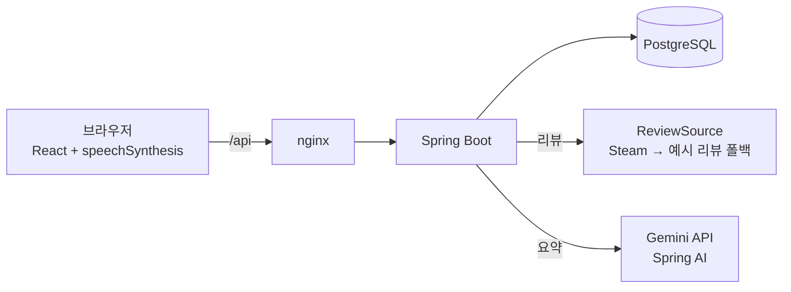

# Game Market

[](https://github.com/euiseok00/game-market/actions/workflows/ci.yml)

게임을 검색해 장바구니에 담고 모의 구매하는 가상 게임 스토어입니다. 게임마다 리뷰를 **Gemini로 요약**해 장점·단점·총평으로 보여 주고, 그 요약을 **브라우저 음성(TTS)으로 읽어 줍니다.** 요약은 첫 요청 때 한 번 만들어 DB에 저장하고, 생성 방식 세 가지(none / lazy / warm)의 응답 시간을 측정해 비교했습니다.

실제 결제나 배포가 없는 포트폴리오 프로젝트입니다. 설계 문서는 [`MVP.md`](MVP.md)에 있습니다.

<p align="center">
  
</p>

## 주요 기능

- **스토어:** 회원가입·로그인, 게임 검색과 장르 필터, 장바구니, 실제 결제 없는 모의 구매, 구매한 게임을 모아 보는 라이브러리
- **AI 리뷰 요약:** 게임 리뷰를 Gemini에 보내 한국어 JSON(`pros`, `cons`, `verdict`)으로 받아 표시합니다. 요약 아래에 근거가 된 리뷰의 출처와 개수를 함께 보여 줍니다.
- **음성 읽기:** 요약을 브라우저 Web Speech API로 읽어 줍니다. 한국어 음성이 없거나 API를 지원하지 않는 브라우저에서는 재생 버튼이 꺼지고 이유를 안내합니다.
- **리뷰 목록:** 요약이 어떤 리뷰로 만들어졌는지 상세 화면에서 누구나 볼 수 있습니다.
- **요약 캐시와 성능 비교:** 같은 게임의 두 번째 요청부터는 외부 API를 부르지 않습니다. 동시에 여러 요청이 와도 요약은 한 번만 만들어집니다.

## 화면

**스토어**


<table>
  <tr>
    <td width="62%" valign="top">
      <b>요약의 근거가 된 리뷰 목록</b><br><br>
      
    </td>
    <td width="38%" valign="top">
      <b>휴대폰 화면 (390px)</b><br><br>
      
    </td>
  </tr>
</table>

**장바구니와 모의 구매**


**구매 완료 후 라이브러리**


## 구조



| 계층 | 기술 |
|---|---|
| 백엔드 | Java 21, Spring Boot 4.1.2, Spring Security(BCrypt, HTTP 세션), Spring Data JPA |
| AI | Spring AI 2.0.2 (`spring-ai-starter-model-google-genai`), 모델 `gemini-3.5-flash-lite`(무료 티어) |
| DB | PostgreSQL 17 |
| 프론트엔드 | React 19, TypeScript, Vite. UI와 음성 재생만 담당하고 모든 서버 로직은 Spring Boot에 있습니다 |
| 테스트·CI | JUnit 5, Testcontainers, Vitest, Playwright, GitHub Actions |
| 실행 | Docker Compose (postgres, backend, frontend+nginx) |

백엔드는 기능별 패키지로 나뉜 모듈형 모놀리스입니다: `auth`, `game`, `cart`, `order`, `review`, `summary`, `bench`.

## AI 요약이 동작하는 방식

1. 사용자가 상세 화면에서 요약을 요청하면(`GET /api/games/{id}/summary`, 로그인 필요) 서버가 먼저 저장된 요약을 찾습니다.
2. 없으면 `ReviewSource`에서 리뷰를 가져와 Gemini에 보냅니다. 응답은 JSON(`response-mime-type=application/json`)으로 받아 검증한 뒤 `review_summary`에 저장합니다.
3. 같은 게임 요청이 동시에 들어오면 게임별 single-flight(`ConcurrentHashMap<Long, CompletableFuture>`)로 한 번만 생성하고 결과를 나눠 씁니다. `review_summary.game_id`의 unique 제약이 마지막 방어선입니다.
4. 모든 요청은 `summary_log`에 리뷰 수집 시간, LLM 시간, 전체 시간을 기록합니다.

**실패 처리:** Gemini가 429나 5xx를 주면 1초, 2초, 4초 간격으로 최대 3번 다시 시도합니다. 잘못된 JSON, 빈 응답, 비어 있는 장점·단점, 20초 타임아웃은 다시 시도하지 않습니다. 실패하면 `503 {"code":"SUMMARY_UNAVAILABLE"}`을 돌려주고 아무것도 저장하지 않으며, 스토어의 다른 기능은 그대로 동작합니다. API 키 없이 실행해도 앱은 뜨고 요약만 503이 됩니다.

## 성능 측정

요약 생성 방식 세 가지의 응답 시간입니다. 게임 25개에 대해 게임당 3번 이상 호출했고, 값은 `summary_log.total_ms`(서비스 내부 시간, HTTP 제외)입니다.

| 단계 | 방식 | 평균 (ms) | p95 (ms) |
|---|---|---:|---:|
| A | none: 요청마다 리뷰 수집 + Gemini 호출 | 1313.7 | 1610 |
| B | lazy: 첫 요청에 생성 후 DB 저장 | 1956.2 | 2062 |
| B | lazy: 이후 요청 (DB에서 읽기) | 11.9 | 33 |
| C | warm: 서버 시작 때 미리 생성 | 4.4 | 12 |

캐시된 요청은 Gemini를 매번 부르는 방식보다 약 110배(lazy), 약 300배(warm) 빨랐습니다. 2026-11-09 측정이며, 전체 표는 [`docs/benchmark.md`](docs/benchmark.md)에 있습니다. 이 측정은 예시 리뷰를 지금 내용으로 바꾸기 전에 했지만, 시간 비교에는 영향이 없습니다.

## 실행

**Docker Compose로 전체 실행**

```bash
export GEMINI_API_KEY=...        # PowerShell: $env:GEMINI_API_KEY = "..."
docker compose up -d --build
```

- 스토어: http://localhost:3000
- API: http://localhost:8080
- PostgreSQL: `localhost:5433` (로컬에 설치된 PostgreSQL의 5432와 겹치지 않도록)

**로컬 개발**

```bash
docker compose up -d postgres
cd backend && ./gradlew bootRun           # :8080
cd frontend && npm install && npm run dev  # :5173, /api는 :8080으로 프록시
```

**설정**

| 환경변수 | 기본값 | 설명 |
|---|---|---|
| `GEMINI_API_KEY` | `not-set` | Gemini API 키. 없으면 요약만 503 |
| `GEMINI_MODEL` | `gemini-3.5-flash-lite` | 요약 모델 |
| `SUMMARY_MODE` | `lazy` | `none` / `lazy` / `warm` |
| `GAMEMARKET_DB_URL`, `_USER`, `_PASSWORD` | `jdbc:postgresql://localhost:5433/gamemarket`, `gamemarket`, `gamemarket` | DB 연결 |

## 테스트

```bash
cd backend && ./gradlew test   # 단위·통합 테스트 48개 (Testcontainers, Docker 필요)
cd frontend && npm test        # 컴포넌트 테스트 14개 (Vitest)

# E2E (Playwright): 실행 중인 스택(기본 http://localhost:3000)을 대상으로 합니다
docker compose up -d --build
cd frontend && npx playwright install chromium && npm run e2e
```

- 백엔드 테스트는 중복 가입, 이미 산 게임 재구매, 빈 장바구니 주문, 동시 요청 20개에 Gemini 1번 호출, 잘못된 JSON·429·타임아웃 같은 경계 상황을 다룹니다.
- E2E는 가입부터 검색, 장바구니, 모의 구매, 라이브러리까지의 흐름과 요약 패널(음성 재생·중지, 503 오류, 음성 미지원)을 실제 브라우저로 확인합니다. Gemini 키와 무료 한도에 기대지 않도록 E2E에서는 요약 API와 음성 엔진을 가짜로 바꿔 씁니다.
- GitHub Actions가 push와 PR마다 백엔드 테스트, 프론트 타입체크·테스트·빌드, Docker Compose 스택 대상 E2E를 실행합니다.
- README 스크린샷은 `cd frontend && SCREENSHOTS=1 npx playwright test screenshots`로 다시 찍을 수 있습니다(실제 Gemini 키로 실행 중인 스택 필요).

## 설계 결정과 한계

- **리뷰는 예시 데이터입니다.** Steam 공식 리뷰 API(`/appreviews/{appid}?json=1`)는 2026-11-09 기준으로 JSON 대신 스토어 홈으로 리다이렉트(302)되어, 로컬과 GitHub Actions 러너 모두에서 받을 수 없었습니다. 헤더를 꾸며 우회하지 않고, 게임마다 실제 특징을 반영해 직접 쓴 예시 리뷰 8개(`seed/reviews.json`)를 씁니다. 화면에도 "예시 리뷰"라고 표시됩니다. Steam이 다시 JSON을 주면 `FallbackReviewSource`가 자동으로 Steam 리뷰를 씁니다.
- **게임 정보는 Steam에서 한 번 받아 저장했습니다.** 이름, 장르, 이미지, 설명은 Steam `appdetails`에서 받은 25개 게임이고, 가격은 모의값입니다.
- **결제는 없습니다.** 모의 구매는 주문 내역과 보유 기록만 만듭니다.
- **CSRF 보호를 껐습니다.** 프론트와 API가 같은 출처(nginx 또는 Vite 프록시)에서 세션 쿠키(`SameSite=Lax`)로 통신한다는 전제입니다.
- **요약 캐시는 리뷰가 바뀌어도 자동으로 갱신되지 않습니다.** 리뷰 데이터를 바꾸면 저장된 요약(`review_summary`)을 지워야 새로 만들어집니다.
- **스키마는 `ddl-auto=update`로 관리합니다.** 마이그레이션 도구(Flyway)는 쓰지 않습니다.
